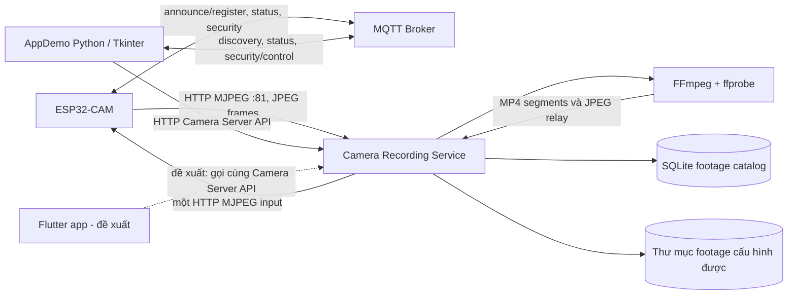

# Hệ thống Camera Smart Home

Tài liệu này mô tả luồng camera đã kiểm tra trong repository `SmartHome_MQTT`, gồm firmware ESP32-CAM, Recording Service, kho footage và AppDemo Python/Tkinter. Nội dung được chia thành **đang có trong source**, **được cấu hình**, và **đề xuất** để tránh nhầm lẫn giữa triển khai hiện tại và kiến trúc tương lai.

## Phạm vi và hiện trạng

| Thành phần | Hiện trạng quan sát trong source |
|---|---|
| Firmware camera | `camera_mqtt/camera_mqtt_vga30/camera_mqtt_vga30.ino`: HTTP status, HTTP MJPEG và MQTT discovery/status/security. |
| Recording Service | `recording_service/`: Python service độc lập, FFmpeg, SQLite, HTTP API, CameraRecorder và StorageManager. |
| Giao diện | `appdemo/mqtt_test_console.py`: AppDemo Tkinter; Camera Center gọi HTTP API của Recording Service. |
| Ứng dụng Flutter | Không tìm thấy mã Flutter trong repository được khảo sát. Tích hợp Flutter bên dưới là đề xuất. |
| Nền tảng vật lý | Code firmware định nghĩa ESP32-CAM AI-Thinker và chân camera; repository không kèm sơ đồ dây, kiểm chứng phần cứng hoặc kết quả đo hiệu năng thực tế. |

**Lưu ý cấu hình quota:** code có fallback 5 GiB và 4.5 GiB, nhưng `recording_service/config.json` hiện tại ghi `max_storage_gib: 0.5` và `cleanup_target_gib: 0.45`. Giá trị cấu hình cụ thể được ưu tiên hơn fallback. Giao diện Storage Settings cho phép thay đổi giới hạn và thư mục footage qua API. Vì vậy không nên coi 5/4.5 GiB là giá trị đang áp dụng cho file cấu hình hiện tại.

## Cấu trúc source liên quan

```text
SmartHome_MQTT/
├── appdemo/
│   ├── mqtt_test_console.py       # MQTT, giao diện thiết bị, Camera Center
│   └── requirements.txt           # paho-mqtt, OpenCV, Pillow
├── camera_mqtt/
│   └── camera_mqtt_vga30/
│       └── camera_mqtt_vga30.ino  # ESP32-CAM, HTTP/MJPEG, MQTT
├── recording_service/
│   ├── __main__.py                # python -m recording_service
│   ├── service.py                 # recorder, HTTP API, lifecycle, config
│   ├── footage_manager.py         # SQLite catalog, quota, cleanup, export
│   ├── config.json                # camera endpoint, storage và quota hiện hành
│   ├── install_recording_task.ps1 # Windows Task Scheduler
│   ├── uninstall_recording_task.ps1
│   └── tests/test_footage.py      # unittest cho catalog, cleanup, API, recorder
└── docs/
    └── CAMERA_SYSTEM.md           # tài liệu hệ thống này
```

Các module chính:

- `CameraRecorder` trong `recording_service/service.py` quản lý một luồng FFmpeg và một worker cho mỗi camera được bật.
- `FootageStore` trong `recording_service/footage_manager.py` lưu catalog SQLite, UTC timestamps, trạng thái segment, đường dẫn tương đối, kích thước và cờ bảo vệ.
- `StorageManager` trong cùng module quản lý quota, file đang hoạt động/được phục vụ, inventory, cleanup và trạng thái cảnh báo.
- `RecordingService` trong `service.py` khởi chạy recorder, HTTP server và các API storage/footage/live/export.
- `CameraCenter` trong `appdemo/mqtt_test_console.py` gọi API nền, hiển thị tình trạng lưu trữ, live stream, timeline và playback.

## Kiến trúc và luồng dữ liệu



Video không được chuyển qua MQTT. ESP32-CAM phát HTTP MJPEG; Recording Service tiêu thụ luồng này, FFmpeg mã hóa H.264/MP4 để ghi, đồng thời chuyển JPEG gốc qua pipe cho live viewer. AppDemo gọi Recording Service thay vì mở trực tiếp URL ESP32. Thiết kế này phù hợp với firmware hiện tại chỉ lưu một stream client trong biến `sc`.

### Luồng khởi động và ghi hình

1. ESP32-CAM khởi tạo camera, kết nối Wi-Fi, MQTT, HTTP status port 80 và MJPEG stream port 81.
2. Khi MQTT kết nối, camera publish discovery tới `smarthome/device/register` và `smarthome/device/announce`, rồi publish status retain tới `smarthome/device/cam01/status`. Nó subscribe security topic `smarthome/device/cam01/security`.
3. Recording Service đọc danh sách `cameras` từ `recording_service/config.json`. Camera enabled được khởi chạy độc lập với giao diện Tkinter.
4. Mỗi `CameraRecorder` chạy một worker và tối đa một FFmpeg child; FFmpeg nối tới `stream_url`, mã hóa video H.264 và cắt segment theo `segment_seconds`. Code giữ một input camera xuyên suốt các lần cắt segment.
5. Segment được tạo dưới tên kết thúc bằng `.partial.mp4`; FFmpeg ghi danh sách segment CSV. Khi segment đã đóng, recorder kiểm tra bằng ffprobe, kiểm tra thời lượng tối thiểu, đổi tên nguyên tử sang `.mp4`, rồi thêm metadata vào SQLite. Chỉ file hoàn tất được đưa vào footage API.
6. Khi kết nối camera lỗi, worker ghi log và retry theo khoảng lùi cấu hình. AppDemo đóng hoặc mở không điều khiển vòng đời recorder.

Trong code, thời lượng segment được đọc từ `segment_seconds`, được giới hạn tối thiểu 30 giây và fallback 300 giây. Firmware đặt VGA 640×480, `fb_count = 1`, và thử phát frame mỗi 33 ms; comment firmware ghi rõ FPS thực tế phụ thuộc cảm biến, JPEG và Wi-Fi. Đây là mục tiêu trong code, không phải số FPS đã đo.

### File và metadata

- Thư mục lưu lấy từ `storage_dir`; mỗi camera có thư mục con an toàn theo camera ID.
- Tên file chứa camera ID đã chuẩn hóa, timestamp UTC, một phần UUID phiên ghi và số thứ tự segment, ví dụ dạng `<camera>_<UTC>_<session>_000001.mp4`. Trong lúc tạo file có hậu tố `.partial.mp4`.
- FFmpeg dùng segment muxer CSV. Segment chỉ được publish sau khi tiến trình FFmpeg thoát sạch và ffprobe xác minh duration đạt `min_complete_ratio` của thời lượng cấu hình.
- SQLite mặc định nằm tại `recording_service/footage.sqlite3` theo cấu hình đường dẫn tương đối `metadata_db`. Bảng `recordings` lưu `recording_id`, `device_id`, `start_time`, `end_time`, `duration`, `file_path`, `file_size`, `status`, `is_protected`, `storage_root`; bật WAL và có index thời gian/trạng thái.
- Dấu thời gian catalog chuẩn hóa UTC; API hỗ trợ truy vấn interval nửa mở `[start, end)` và trả gap tường minh.
- File export được đặt trong thư mục `exports`; export tạm kết thúc `.partial.mp4`, chỉ đổi sang `.mp4` sau khi tạo và probe thành công.

## API của Recording Service

Mặc định trong code, service bind `127.0.0.1:8765`; `config.json` hiện cấu hình `http_host` thành địa chỉ LAN. AppDemo hiện đặt base URL trong `mqtt_test_console.py`, vì vậy địa chỉ đó phải khớp máy host và cấu hình service. Service dùng `ThreadingHTTPServer`.

| Method | Route | Mục đích |
|---|---|---|
| GET | `/api/status` | Trạng thái service, recorder, storage, dung lượng ổ đĩa/cảnh báo. |
| GET | `/api/storage/settings` | Đọc storage directory, quota, cleanup, thời lượng segment. |
| POST | `/api/storage/validate` | Tạo/kiểm tra thư mục và quyền ghi trước khi lưu cấu hình. |
| POST | `/api/storage/settings` | Cập nhật thư mục, max GiB, cleanup target và bật/tắt cleanup. |
| GET | `/api/footage` | Danh sách segment cho ngày/giờ local hoặc timestamp ISO timezone-aware. |
| GET | `/api/playback/manifest` | Segment playback có URL và các gap trong khoảng yêu cầu. |
| GET | `/api/recordings/{uuid}` | Metadata của một recording hoàn tất. |
| GET | `/api/recordings/{uuid}/file` | MP4; hỗ trợ byte range để seek. |
| POST | `/api/footage/{uuid}/protection` | Đặt `is_protected` cho segment hoàn tất. |
| POST | `/api/live-sessions` | Tạo phiên live cho `device_id`. |
| GET | `/api/live-sessions/{uuid}/stream.mjpg` | Nhận JPEG mới nhất từ input chung của recorder. |
| DELETE | `/api/live-sessions/{uuid}` | Đóng viewer session, không dừng ghi hình. |
| POST | `/api/export` | Tạo MP4 cho khoảng thời gian chọn. |
| GET / DELETE | `/api/exports/{uuid}` | Tải/xóa file export. |

> Các route trên được liệt kê từ handler hiện tại trong `service.py`. HTTP hiện không có xác thực người dùng hay token trong handler. Không nên expose service ra Internet hoặc mạng không tin cậy khi chưa bổ sung xác thực, TLS và kiểm soát truy cập.

## Storage Manager và cấu hình thư mục

### Hành vi được triển khai

- AppDemo mở **Storage Settings** trong Camera Center; người dùng chọn đường dẫn qua dialog, nhập giới hạn GiB, cleanup target và bật/tắt cleanup.
- UI gửi thay đổi qua `/api/storage/settings`; `/api/storage/validate` xác thực thư mục. Service resolve path, tạo thư mục nếu thiếu, kiểm tra dung lượng ổ đĩa và thử tạo/flush/xóa file probe. Cấu hình chỉ được ghi sau validation.
- Nếu đổi storage root, service dừng các recorder để FFmpeg đóng segment, chuyển đường dẫn và manager sang root mới, lưu JSON qua file tạm rồi `os.replace`, sau đó restart recorder. Nếu không dừng an toàn thì cấu hình path không đổi. Footage cũ không được tự động di chuyển; metadata giữ `storage_root` cũ.
- Cleanup được yêu cầu sau segment mới và chạy bằng một worker bounded queue kích thước 1; các yêu cầu trùng được gộp. Khi vượt max, manager chọn segment complete cũ nhất, bỏ qua protected, active, in-use và file không thuộc root quản lý; xóa file trước, chỉ đổi metadata sang `deleted` sau khi `unlink` thành công.
- Nếu volume mất, thiếu quyền, hoặc các file có thể xóa không đủ để về target, trạng thái storage chứa warning/error và logger ghi sự kiện. `status` dùng dung lượng cache; kiểm kê/cleanup mới quét file.
- Khởi động service gọi reconcile: kiểm tra bản ghi complete với file và kích thước, đánh dấu recording bị ngắt là incomplete, và ghi log MP4 trong root không có index. File partial/incomplete và file unindexed không đủ điều kiện cleanup.

### Các giới hạn cần lưu ý

- Đổi root không chuyển footage cũ. Catalog dùng `storage_root` theo từng bản ghi để vẫn truy ra vị trí cũ, nhưng status/quota hiện hành tập trung vào root mới; quản lý dung lượng nhiều root/di chuyển dữ liệu chưa phải workflow riêng.
- Nếu ổ đĩa chứa root cũ bị tháo, catalog có thể giữ bản ghi nhưng file không truy cập được cho tới khi volume trở lại. API báo lỗi/missing theo tình trạng kiểm tra; không nên coi metadata còn là bảo đảm file còn đọc được.
- Đổi root yêu cầu recorder stop/restart nên tạo một khoảng gián đoạn thu hình. Việc cắt segment đúng lúc được thử bằng shutdown FFmpeg; không thể bảo đảm không có gap nếu thiết bị hoặc ổ đĩa lỗi trong lúc chuyển.
- Cleanup bị tắt thì file vẫn được kiểm kê để status nhưng quota không tự xóa file. Dung lượng đĩa có thể hết trước giới hạn cấu hình nếu volume nhỏ.
- Khi cleanup đang chạy, việc kiểm kê file là thao tác I/O đệ quy. Nó không chạy trên Tkinter main thread nhưng có thể tạo tải đĩa đáng kể trên kho rất lớn; hiện chưa có benchmark xác nhận ngưỡng hoạt động.

## Luồng AppDemo và tác vụ nền

- AppDemo entry point là `appdemo/mqtt_test_console.py`; tạo Tk root, khởi tạo MQTT và dựng giao diện Fan/Relay/Camera. Camera Center là cửa sổ Tk riêng.
- MQTT callback xử lý announce/register, status và security. Discovery gần thiết bị có TTL, dọn stale qua `root.after` định kỳ. MQTT duy trì trạng thái/khám phá/security; không mang video.
- Camera Center gọi HTTP ở thread daemon thông qua `_run_worker`; kết quả được đưa về UI bằng `window.after`. Poll status định kỳ cập nhật trạng thái camera/storage.
- Live có worker HTTP đọc MJPEG và worker pump cập nhật khung hình; playback dùng OpenCV đọc file export. Cập nhật nhãn/timeline diễn ra qua Tk event loop. Chỉ một pump live/playback được cho phép theo trạng thái bận.
- Service có một recorder thread mỗi camera, một cleanup worker, FFmpeg process, HTTP server đa luồng và worker/API handler cho request. Export chạy FFmpeg trong request worker. Concurrent HTTP clients vì vậy có thể dùng CPU/đĩa cùng recorder và playback.
- Service status trả cached usage thay vì quét file mỗi request. Tuy nhiên `FootageStore.reconcile()` và cleanup inventory có traversal filesystem; chúng cần được xem xét riêng khi đo cold-start và kho lớn.

## Windows khởi chạy tự động

`recording_service/install_recording_task.ps1` tạo Scheduled Task cho user hiện tại:

- Trigger tại user logon, chạy module với working directory là `SmartHome_MQTT` và config ở `recording_service/config.json`.
- Bản cài chọn `pythonw.exe` nếu có, task chạy quyền user hạn chế, giới hạn instance là `IgnoreNew`, cấu hình restart khi process lỗi.
- Vì trigger là user logon (Interactive), đây không phải Windows Service chạy trước đăng nhập. AppDemo và Scheduled Task có thể độc lập sau khi user đăng nhập.
- Lệnh cài và gỡ được mô tả trong `SmartHome_MQTT/README.md`; cần đảm bảo Python, FFmpeg và ffprobe sẵn có trong môi trường của task.

## Flutter / Android: phương án tích hợp đề xuất

> Không có project Flutter, Android manifest hoặc client Dart trong repository đã khảo sát. Do đó các điểm sau chưa được triển khai hay kiểm thử.

Khuyến nghị Flutter gọi cùng Recording Service API qua HTTP(S), không kết nối ESP32 trực tiếp và không phát video qua MQTT:

1. Màn hình storage đọc `GET /api/status` và `GET /api/storage/settings` để hiển thị used/max, dung lượng volume, cảnh báo, cleanup và storage directory.
2. Cho phép cấu hình giới hạn và vị trí qua `POST /api/storage/validate`, rồi `POST /api/storage/settings`. Dùng native directory picker; gửi đường dẫn mà **máy Recording Service** nhìn thấy. URI `content://` của Android không phải filesystem path dùng được trên PC service.
3. Live mở phiên `POST /api/live-sessions`, rồi đọc MJPEG URL trả về; khi rời màn hình phải gọi `DELETE` session. Recorder vẫn hoạt động độc lập.
4. Footage lấy manifest qua `GET /api/playback/manifest`, phát từng `playback_url` có byte-range và biểu diễn `gaps`; đóng/xóa export theo API sau khi phát xong.
5. Nếu Android là thiết bị khác, không dùng `127.0.0.1` hay địa chỉ loopback trên điện thoại: cấu hình service bind một interface LAN tin cậy và dùng hostname/IP của PC. Cần xác thực, HTTPS/TLS hoặc VPN, firewall và chính sách quyền riêng tư trước khi cung cấp API tới LAN. Android cleartext HTTP cũng có thể bị nền tảng chặn tùy manifest/network security config; ưu tiên HTTPS.

## Kiểm thử có trong repository và khoảng trống

Test hiện có ở `recording_service/tests/test_footage.py`, dùng `unittest`, temporary directories, HTTP server cục bộ và fake/mock FFmpeg probe ở một số đường chạy. Các nhóm được bao phủ gồm segment/catalog/timestamp/gap, restart metadata, active/protected cleanup, đường dẫn an toàn, export, storage settings API, live session và file range/API.

Chưa thấy test tự động cho AppDemo Tkinter end-to-end, MQTT broker/ESP32 thật, firmware build/hardware camera, Windows Task Scheduler thực, FFmpeg/ffprobe production với thiết bị thật, đổi ổ đĩa khi đang quay, mất ổ giữa ghi/xóa, đĩa đầy, volume network removable, tải đồng thời live/playback/export, hoặc tích hợp Flutter. Có test code không đồng nghĩa các test đã được chạy trong lần cập nhật tài liệu này.

### Bổ sung test trước khi phát hành

1. **Storage path/config:** path không hợp lệ, volume root bị từ chối, tạo thư mục, read-only/đĩa mất, probe cleanup, ghi JSON thất bại và rollback đầy đủ.
2. **Retention integrity:** bảo vệ segment, active recording, playback/export đang giữ file, unlink permission error, stale/missing file, unindexed/partial/symlink/outside-root, bảo đảm metadata chỉ `deleted` khi unlink thành công.
3. **Recovery:** restart với file `.partial.mp4`, SQLite row `recording`, file thiếu, kích thước sai, root cũ đang offline rồi online lại.
4. **Concurrency:** không tạo cleanup worker trùng; request cleanup nhiều lần coalescing; race giữa delete và tải Range/protection; root change khi recorder và export hoạt động.
5. **Performance đo thực tế:** thời gian cleanup/reconcile, latency API status và footage, thời gian frame UI khi live/playback, CPU/RAM/đọc ghi đĩa ở kho nhỏ và kho lớn; ghi số liệu baseline và tải thử. Chưa có kết quả đo nên chưa thể khẳng định mục tiêu độ trễ.
6. **System/hardware:** camera ngắt/reconnect, restart service trong segment, thay đổi storage trên ổ khác, Task Scheduler sau logon và FFmpeg/ffprobe binaries thực tế.
7. **Flutter (khi triển khai):** API contract, HTTP Range, lifecycle live session, timezone/gap, lỗi mạng, xác thực/TLS, quyền chọn thư mục và thiết bị Android ở mạng khác.

## Cài và chạy kiểm tra thủ công

Các bước Windows hiện được mô tả ở `SmartHome_MQTT/README.md`. Tóm tắt: cài dependency AppDemo, cài FFmpeg/ffprobe, kiểm tra `stream_url` và `http_host`/base URL, chạy `python -m recording_service`, rồi khởi động `appdemo/mqtt_test_console.py`. Có thể kiểm tra `/api/status` và mở Camera Center. Đây là hướng dẫn vận hành từ tài liệu dự án; tài liệu này không khẳng định đã chạy kiểm thử trong lượt viết README.

## Tham chiếu source

- Firmware, MQTT, HTTP MJPEG và camera capture: `camera_mqtt/camera_mqtt_vga30/camera_mqtt_vga30.ino`.
- FFmpeg lifecycle, segment finalize, retry, HTTP endpoints: `recording_service/service.py`.
- Schema, reconcile, cleanup/quota, file locks, export: `recording_service/footage_manager.py`.
- Storage UI, worker/API calls, live/playback pump, MQTT UI integration: `appdemo/mqtt_test_console.py`.
- Runtime values: `recording_service/config.json`.
- Windows Scheduled Task: `recording_service/install_recording_task.ps1` và `uninstall_recording_task.ps1`.
- Automated tests: `recording_service/tests/test_footage.py`.
